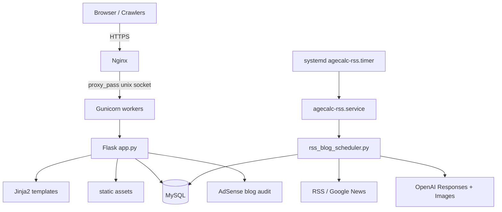
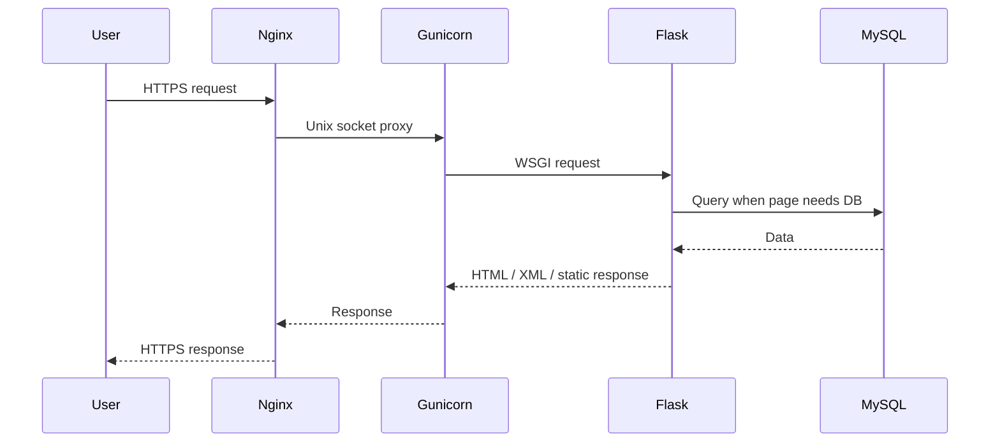

# AgeCalc Architecture

AgeCalc는 Flask 단일 앱을 중심으로 한국어·다국어 계산기, 안내 페이지와 블로그를 제공하고, 별도 systemd timer가 RSS 기반 블로그 초안을 생성합니다.

## Runtime


원본 Mermaid 파일: [docs/diagrams/runtime-architecture.mmd](diagrams/runtime-architecture.mmd)

## Request Flow


## Main Modules
| Path | Role |
| --- | --- |
| `app.py` | Flask routes, navigation, sitemap, blog public/draft/review gates |
| `models/blog_models.py` | RSS source/item, generated post, source mapping ORM models |
| `scripts/rss_blog_scheduler.py` | RSS ingest, OpenAI generation, image generation, draft creation |
| `scripts/rewrite_blog_posts.py` | 기존 블로그 글을 상태별로 재작성하고 검수 통과 시 `draft` 또는 `published`로 전환 |
| `scripts/adsense_blog_review.py` | 공개 전 품질/정책 리스크 검사 |
| `templates/` | Jinja2 page templates |
| `static/` | CSS, JS, favicon, generated cover images |
| `systemd/` | RSS 스케줄러 systemd template (앱 서비스는 배포 가이드 예시와 실제 서버 설정 대조) |
| `nginx/agecalc.conf` | production Nginx reverse proxy config |

## Public Indexing Rules
- 계산기/안내 페이지는 registry의 indexable·공개 정책을 충족할 때 sitemap에 포함됩니다.
- 종료된 미니게임 경로는 공개 탐색과 sitemap에서 제거되었고 404를 반환합니다.
- 블로그 목록과 상세는 `BLOG_PUBLIC_INDEXING_ENABLED=true`, `ADSENSE_REVIEW_MODE=false`, 공개 글이 `BLOG_INDEX_MIN_POSTS` 이상이라는 조건을 모두 충족할 때 sitemap에 포함됩니다.
- 다국어·지역별 계산기는 registry의 locale allowlist에 등록된 실제 문서만 sitemap과 hreflang에 포함됩니다.
- `draft`와 `needs_review`는 public route에서 접근되지 않습니다.

## 프로젝트 구조
```text
agecalc/
├── app.py
├── db.py
├── controllers/
├── models/
│   ├── age_calculator.py
│   └── blog_models.py
├── scripts/
│   ├── rss_blog_scheduler.py
│   ├── rewrite_blog_posts.py
│   ├── adsense_blog_review.py
│   └── adsense_preflight.py
├── templates/
├── static/
├── systemd/
├── nginx/
├── docs/
├── tests/
├── requirements.txt
├── environment.yml
├── readme.md
├── BLOG_POSTS_SCHEMA.md
└── DEPLOYMENT_GUIDE.md
```


세부 경로는 [라우트 안내](ROUTES.md), 환경 설정은 [개발 안내](DEVELOPMENT.md), 광고·색인 조건은 [공개 정책](operations/runtime-policy.md)을 참고하세요.
